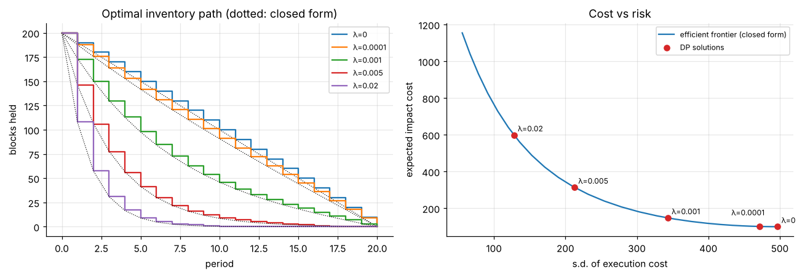
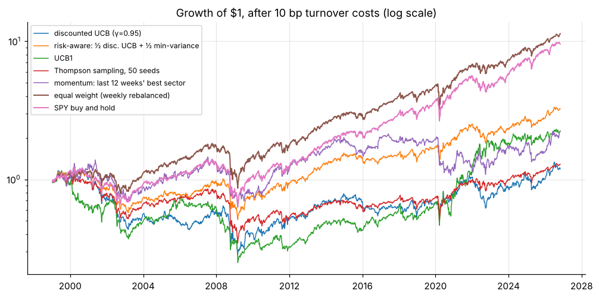
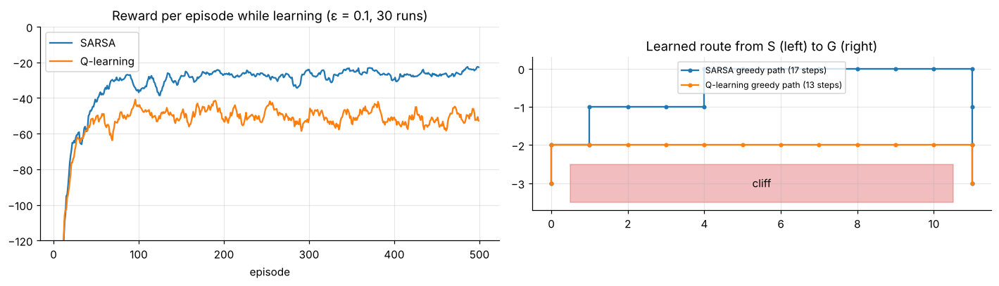

# Reinforcement Learning & Dynamic Programming for Finance

Sequential decision-making applied to three finance problems: **which asset to hold** (multi-armed bandits), **how to sell a large position** (dynamic programming, Almgren-Chriss) and **when to be in the market** (Q-learning). Each method is first checked on a problem with a known answer, then tested on real data out of sample, net of costs and against simple benchmarks. Results are reported as measured, including where reinforcement learning adds nothing.



## Studies

| # | Notebook | Method | Main result |
|---|---|---|---|
| 1 | [Bandits for sector rotation](notebooks/01_bandits_sector_rotation.ipynb) | ε-greedy, UCB1, discounted UCB, Thompson sampling, risk-aware blend; 9 sector ETFs, 1,451 weeks | Thompson sampling has the lowest regret on simulated arms, but on real sectors **no bandit beats equal weight** (Sharpe 0.60 vs at best 0.46 after costs). Weekly returns are too noisy to learn from |
| 2 | [Dynamic programming](notebooks/02_dynamic_programming_execution_and_allocation.ipynb) | Backward induction for optimal execution; value and policy iteration for a regime-switching allocation with costs | DP matches the closed-form Almgren-Chriss path within one block and traces the cost-risk frontier. The regime policy (100% / 25% equity) halves the drawdown |
| 3 | [Q-learning trader](notebooks/03_q_learning_trading_agent.ipynb) | SARSA vs Q-learning on the cliff walk; tabular Q-learning on trend × volatility states, 5 ETFs, yearly retraining | The agent mostly **learns buy-and-hold** (out-of-sample Sharpe 0.67-0.74 vs 0.72 on SPY) and beats it in 1 of 15 years |

<p float="left">
  
  
</p>

## Why the negative results are included
Notebooks 1 and 3 show reinforcement learning failing to beat simple rules on daily and weekly returns, and explain why: low signal-to-noise, turnover costs and non-stationarity. Knowing where a method does **not** work is part of using it responsibly. Notebook 2 shows where these tools are reliable: problems whose dynamics are known, such as execution scheduling and cost-aware rebalancing.

## Quick start

```bash
git clone https://github.com/drimranbhatti/reinforcement-learning-finance.git
cd reinforcement-learning-finance
pip install -e ".[notebooks,dev]"
pytest                          # 8 tests
python scripts/fetch_data.py    # optional: refresh price snapshots
jupyter lab notebooks/
```

```python
from rlfin import bandits, mdp, trading
log = bandits.backtest(weekly_returns, bandits.UCB1(k=9, c=0.03), cost=0.001)
V, policy = mdp.solve_execution(X=200, N=20, eta=0.05, sigma=1.0, lam=1e-3)
Q = trading.train_q(states, next_returns, n_market=9, episodes=60)
```

## Package
`src/rlfin/`: `bandits` (ε-greedy, UCB1, discounted UCB, Gaussian Thompson sampling, regret simulation, sequential backtest with turnover costs) · `mdp` (finite-horizon execution DP, Almgren-Chriss closed form, value and policy iteration) · `tabular` (Q-learning, SARSA, cliff walk) · `trading` (state construction from training-period quantiles, Q-learning trader, performance statistics)

Tests check that UCB and Thompson sampling find the best arm, that the backtest uses only past rewards, that DP matches the closed form and gives TWAP when risk-neutral, that value and policy iteration agree, that Q-learning solves the cliff walk, and that trading costs are charged correctly.

## Data
Adjusted daily closes from Yahoo Finance, snapshots in `data/`: the nine original SPDR sector ETFs and SPY (1999-2026), and SPY, QQQ, TLT, GLD and EEM (2005-2026).

## References
Sutton & Barto, *Reinforcement Learning: An Introduction* (2018) · Auer, Cesa-Bianchi & Fischer (2002) · Garivier & Moulines (2011) · Huo & Fu, *Risk-aware multi-armed bandit problem with application to portfolio selection* (2017) · Almgren & Chriss, *Optimal execution of portfolio transactions* (2000)

---
**Author:** Dr. Muhammad Imran Bhatti, PhD (Finance), MScFE · FCMA · [LinkedIn](https://www.linkedin.com/in/drimranbhatti) · [imranbhatti.com](https://imranbhatti.com)

*Built on my MScFE stochastic-modelling coursework (WorldQuant University) and rewritten as standalone studies. Research only; not investment advice. MIT licensed.*
